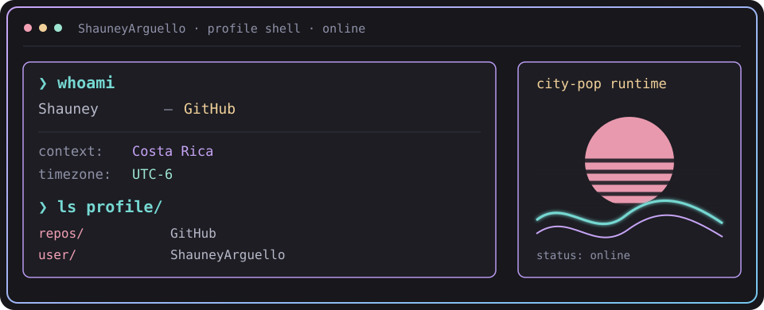

<picture>
  <source media="(prefers-color-scheme: dark)" srcset="assets/banner-dark.v9.svg">
  
</picture>

---

## `$ whoami`

## `$ ls repos/`

[Explorar mis repositorios de GitHub](https://github.com/ShauneyArguello?tab=repositories)
