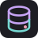

<picture>
  <source media="(prefers-color-scheme: dark)" srcset="assets/banner-dark.v9.svg">
  
</picture>

---

## `$ whoami`

## `$ ls repos/`

[Explorar mis repositorios de GitHub](https://github.com/ShauneyArguello?tab=repositories)

---

> Las tecnologías y puntuaciones de estas dos secciones son ejemplos del perfil de referencia.

## `$ cat tech-stack.yaml`

<table border="1" cellpadding="14" bgcolor="#17171c">
  <thead>
    <tr>
      <th colspan="2" align="left"><code>ShauneyArguello:~$ cat tech-stack.yaml</code></th>
    </tr>
  </thead>
  <tbody>
    <tr>
      <td width="50%" valign="top"><code>├─ ☁ cloud_infrastructure:</code>  
         
        <code>AWS · Azure · Ansible</code>
      </td>
      <td width="50%" valign="top"><code>├─ ▣ databases_messaging:</code>  
        
         
        <code>Amazon RDS · MySQL · PostgreSQL · MongoDB</code>
      </td>
    </tr>
    <tr>
      <td colspan="2" valign="top"><code>├─ ⚙ containers:</code>  
         
        <code>Docker</code>
      </td>
    </tr>
    <tr>
      <td colspan="2" valign="top"><code>├─ ✦ languages_frameworks:</code>  
         
        <code>Node.js · JavaScript · React · Next.js · TypeScript · Python</code>
      </td>
    </tr>
  </tbody>
  <tfoot>
    <tr>
      <td colspan="2"><code>status: ready&nbsp;&nbsp;·&nbsp;&nbsp;environment: production</code></td>
    </tr>
  </tfoot>
</table>

## `$ kubectl get signals --all-namespaces`

  <picture>
    <source media="(prefers-color-scheme: dark)" srcset="assets/radar-dark.svg">
    <source media="(prefers-color-scheme: light)" srcset="assets/radar-light.svg">
    
  </picture>&nbsp;
  <picture>
    <source media="(prefers-color-scheme: dark)" srcset="assets/radar-langs-dark.svg">
    <source media="(prefers-color-scheme: light)" srcset="assets/radar-langs-light.svg">
    
  </picture>

<code>signals: devops_skill_radar · language_stack_radar · status: healthy</code>

<!-- SOCIALS -->
